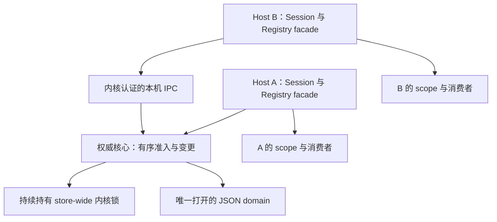

# 多 Host 共享 Registry 权威服务

> 当前实现的架构与协议。决策：[ADR-0025](../decisions/ADR-0025-shared-registry-authority.md)，撤权语义：[ADR-0024](../decisions/ADR-0024-registry-operation-admission.md)。本文件从 2026-10-29 的 Proposed 审计演进；实现与平台验收是两件事，精确执行结果和待验证平台仅记[路线账本](../plans/active/2026-09-12-multi-root-workspace.md#多-host-权威服务开发2026-10-29)。未发布。

## 1. 边界与数据流

多个 Host 使用同一物理登记介质，但始终只有持有内核 lease 的 Host 打开 JSON domain。其 Registry 承载服务端，其他 Registry 实例是 facade：经本机 IPC 提交管理操作和本次操作的 admission，将结果仍从 Registry 发布到本 Host 的 scope。



实现落点：`registry.ts` 内的唯一写入/重分类/排序核心与 owner/follower facade；`authority/protocol.ts` 的服务端和客户端；`authority/native*.ts` 的认证传输；`compat/authority-storage.ts` 的公开存储适配；`registry-operation.ts` 的短生命周期执行上下文。不存在另一个持久化根表或 scope 写口。

首版范围是同机器、同 OS 用户、同锁命名空间、同物理介质；主根键仍是 canonical Session origin，不合并各项目授权。Windows 限同登录会话（lease 为 `Local\\` semaphore）。网络盘、跨机器、不同用户、容器间不同挂载视图不在合同内。权威 Host 的事件循环停顿会暂停其他 Host 的新授权。

## 2. 配置、介质与角色

bundle 的 `multi-root-registry` 行配置：

```yaml
sharedStorageRoot: !!js dshHomePath('storages')
leasePath: !!js dshHomePath('storages/multi_root_workspace.lock')
maxAdditionalRoots: 16
```

共享 Registry 自己以公开 `JsonStorageBackend` / `DomainFacility` 打开显式介质，不猜测 host 的 storageDomain 路由。修改 Registry 存储目录时同时修改以上两条路径；其他领域的 `storage-json.root` 不改变此绑定。lease 必须是该物理目录下固定名 `multi_root_workspace.lock`；拒绝替代锁名。没有 `sharedStorageRoot` 的内部/旧组合仍按 ADR-0007 单持锁者授权运行。

介质 ID 是 canonical 物理目录及其 dev/inode 的 SHA-256；Windows 路径折叠大小写。POSIX endpoint 位于 UID 所有且非符号链接的 0700 `/tmp/dsh-registry-<uid>/` 下，短哈希名不随 store 路径增长。Windows 使用本机 pipe。endpoint 不是凭据，知道它也不能越过认证。

Registry `authority.kind`：`active` 为本进程管理介质，`follower` 为连接到权威服务，`contended` 为无法取得锁且共享服务尚不可确认；保留 `storage-failed/config-invalid`。`available` 包含 active/follower，`epoch` 指当前连接/核心身份。同步 `list()` 是可展示的最近记录，可能保留拒绝边界；不代表实时 grant。`refresh()` 是重新分类/同步及按需接管入口，`granted()` 在共享失联时不返回旧 grant。

## 3. 授权与版本协议

采用“新操作有序，在飞短操作可完成”。mutation 与 admission 在 owner 的同一 store-wide 队列中排序；owner 自己也走此逻辑。mutation 的读 → 重新分类 → 校验 → 持久化 → 发布不拆开。admission 重新分类但不写数据；返回后实际 I/O 在队列外运行。

撤权成功后发起的新 admission 使用撤权后的权限；先前已获准的调用仍可稍后完成 I/O 或启动进程。撤权应答不承诺所有旧效果已经消失，也不等待失联 Host。已启动进程、旧 PTY 的新命令及池化 LSP server 的自主访问按启动快照处理，需要立即回收时须终止或重建。

线协议为版本 1 的严格 NDJSON。请求含 `protocol/store/id/epoch/method/args`；首次 `hello` 的 epoch 为 null，核对 store、协议和根数量上限后才接受其他请求。管理方法覆盖 add/removeAt/access/alias/Skills metadata/move/recheck；`snapshot` 和 `admit` 返回全量状态：

```text
{ protocol: 1, store, epoch, revision, primary, roots, available }
```

每次成功打开产生随机 epoch；revision 覆盖有效状态、顺序和 Skills metadata 的真实 publication，重复同值刷新不增版、不通知。每个主根只接受同一连接/epoch 下不倒退的完整快照；跨主根不共享授权集合。连接建立先订阅再取 snapshot；通知携完整快照，跳过 revision 不要求重放增量。旧连接/epoch 的响应不能复活当前投影。

新操作始终向核心请求 admission，本地 scope、缓存和通知只辅助显示/失效，不能单独批准。facade 用 owner 的原始三态记录，交本地 scope 与 Session mode、可信工具 cap 求交；owner 的工具配置不替 follower 决策。

资源有界：帧/待发送缓冲 1 MiB，连接 32，每连接及整个服务的在途请求均至多 32，超时 5 秒；每连接保留最多 2048 个 mutation ID 的紧凑结果（不缓存完整根快照），到上限断线重同步，不淘汰后把同 ID 当新 mutation。相同 mutation ID 相同参数等待原结果，成功后返回最新视图而不重复写入；参数不同断线。只读请求不积累去重快照。握手启动重试最多三次，延迟 0/50/150ms；无后台高频抢锁。客户端超时/断线报告“结果不明”，不自动重放 mutation；先 refresh 对账，再处理冲突。内存去重不提供跨 epoch exactly-once。

## 4. IPC 权限边界

信任正常 Host 与用户本人的代码；受限 agent 进程不因同用户或知道 endpoint 获得 Registry 管理权限。无可读取的 bearer 文件；POSIX fd 设 CLOEXEC，Windows handle 不继承。服务端和客户端均检查实际内核 peer，防止受限进程伪造权威端点。

| 平台 | 实际认证 | 能力不足时 |
| --- | --- | --- |
| macOS | `LOCAL_PEERTOKEN` 的 audit token（含 pidversion、UID），`sandbox_check_by_audit_token` 拒绝已沙箱化 peer | 缺失 SPI/无法确认时连接失败；不退回 PID-only |
| Linux | `SO_PEERCRED` 同 UID，`SO_PEERPIDFD` 固定 peer 身份，`/proc` 的所有 UID 一致且 `NoNewPrivs=0`，pidfd 未退出 | 缺少 SO_PEERPIDFD 的旧内核不提供跨 Host 共享，保守不可用；无 PID-only fallback |
| Windows | pipe 客户端通过 impersonation token 认证；服务端经 kernel 返回的进程与 token 认证；同用户，非 restricted、非 AppContainer、完整性至少 medium，且无 ambient-deny SID | 不能取得/验证 token 时拒绝连接 |

DSH 的 bwrap/Landlock 执行通过 NoNewPrivs 限制；Windows ACL runner 使用 restricted token，ambient deny runner 带专用 deny SID；Seatbelt 的 audit-token 检查与可读写路径无关。受限 agent 即使能读 endpoint 所在目录、全部协议源码或登记 JSON，也不能申请管理操作。正常 Host 自身被外层沙箱化时，不应绕过认证；这属于共享能力诊断，不是免认证开关。

原生调用采用 Koffi，Darwin arm64 的 `fcntl` 必须声明为 variadic 并传类型/值对，才能确实设置 O_NONBLOCK/CLOEXEC。固定参数签名会造成 accept 阻塞事件循环。Windows pipe 为本机、非阻塞；提前断开的 pending client 会重建 pipe instance。

依据：[Apple LOCAL_PEERTOKEN 定义](https://github.com/apple-oss-distributions/xnu/blob/main/bsd/sys/un.h)、[WebKit Sandbox SPI 声明](https://github.com/WebKit/WebKit/blob/main/Source/WTF/wtf/spi/darwin/SandboxSPI.h)、[Linux 6.5 socket 接口定义](https://github.com/torvalds/linux/blob/v6.5/include/uapi/asm-generic/socket.h)、[Windows pipe impersonation](https://learn.microsoft.com/en-us/windows/win32/ipc/impersonating-a-named-pipe-client)。认证测试与本机实测范围见路线账本；不能以 macOS 结果冒充 Windows/Linux 原生结果。

## 5. 同步消费与全消费者接缝

`registry.withOperation(policy, kind, body)` 返回 Promise，取得当次身份/冻结 scope 后在 callback 内建立 ALS；callback 完成或失败即使 async 后代继承了 ALS 也已失效。身份含 operation UUID、epoch、revision、primary 和 mode，不是可序列化/可复用的远端凭证。新嵌套操作在断线后也不得继承外层旧 grant。

`scope.snapshot(policy)` 是展示投影；共享模式的同步 `resolve/scopeOf` 只向有效本次上下文提供附加授权，无上下文时保守主根。根写口仍只有 Registry 调用的 `setAdditionalRoots()`；`setRegistryAuthority()` 只发布可用性，只有真实变化才通知，保留 Issue #24 hot-fix。

| 消费者 | 实现边界 |
| --- | --- |
| fs write/edit | 每调用独立 admission；保留 recordedPath、执行时 canonical/stat 重检、每根权限与工具上限；普通 fs read 仍是上游的用户读权限 |
| sandbox | `confine` 同步/异步形状由兼容层保留；只消费当次 scope；未知权威不给共享 temp；profile 在本次上下文登记 |
| shell / PTC / sync spawn | 异步公开入口重新准入；同步入口借可信工具的异步 waterfall 上层。没有准入只收窄主根；直接调用同步 handle 的 Host 须显式 `await registry.withOperation(policy, 'process', async () => { const handle = shell.execute(spec); return handle.result() })`。旧/复制 argv 不在新上下文登记，拒绝复用；工具 cap 改变同样拒绝旧 profile |
| agent PTY | `DSH_PTY_SESSION_ID` + live session 推导 policy；启动前新准入并重建 profile，检查路径身份；用户控制器终端透传。已启动 PTY 是快照例外 |
| LSP | 每 query 新准入后路由；不改已有 server 进程的快照生命周期 |
| Files | list/stat/read/readBytes 及存在的旧 readAll/readRelated 逐调用准入；related tail 检查；watch 开始与每帧重新准入，真实撤销/失联可取消旧附加根流 |
| instructions | pre-step 读取及最终投递前确认，epoch/根变化重试或延期，成功才记 delivery；保留显式 revocation/withdrawal |
| Skills | discovery/load、原生缓存读取都取得新准入；定位符/reader/receipt 绑定 epoch，旧 epoch 不复活；每根开关、aliasId 与本 Host 全局设置仍有效 |
| topology / command / panel / review | 读取展示投影或取得审阅 admission；浏览器继续只传 live sessionId，主根由各自 Host 推导；mutation 错误保留结果不明信息 |

`read-only` 是写权限限制，不是通用读取 ACL；已确认可用状态下 Files 的上游用户读语义、LSP 的原有非附加路由语义仍在。未知状态不同：Files 不得通过空缓存读取外部路径。

## 6. 故障、退出与接管

断线立即停止新附加授权，保留最后已知记录与 withheld deny；Full-access/Workspace-write 主根范围且无共享 temp，显式 deny 优先。Files 即使缓存从未载入也拒绝未知外部读。下一次操作/refresh 按需重连；只允许安全 query 重试，mutation 不重放。

owner 正常退出先停止连接/新请求，随后在 authority 队列中停止准入、排空 mutation、撤销发布、close domain、最后 release lease。POSIX endpoint 清理核对 inode，旧 disposer 不删除继任者 socket。owner 崩溃后候选只用原内核锁竞选；胜者从磁盘打开并产生新 epoch。暂停的 owner 仍持锁，超时不会让其他 Host 夺权；旧实例重启后成为 follower 或重新正常竞选，不能复用旧 domain。

存储打开失败继续持锁，修复后可 refresh 重试。已打开 domain 的写入若报 `unknown-state`，保留拒绝信息、断开共享服务并隔离至重启，不重新打开另一个内存快照。明确失败的写不发布新 grant。

Windows contender 在零超时等待失败后立即关闭 semaphore handle，连接期间不保留 waiter handle。关闭 handle 不恢复 count；崩溃恢复依赖最后一个 handle 关闭后对象销毁。不得改成长寿命 waiter；多候选崩溃用例必须在 Windows 原生执行。[Microsoft semaphore 语义](https://learn.microsoft.com/en-us/windows/win32/sync/semaphore-objects)。

## 7. 可重复验收

`tests/shared-registry-multiprocess.e2e.ts` 通过独立 Node/V8、生产 Registry/JSON/fs 和真实 IPC 构造并发同/异主根 mutation、写入准入屏障、跨实例撤权、SIGKILL、多候选竞选、旧 holder 重启与暂停不夺锁。`tests/shared-registry.spec.ts` 补充丢通知、丢已提交应答不重放、失联嵌套操作与正常接管；`tests/shared-consumers.spec.ts` 覆盖同步/异步进程、复制 profile、PTY、Skills 缓存、Files/LSP 与 unknown-state。`tests/authority-native.spec.ts` 覆盖真实 peer gate、请求去重/冲突，按平台执行受限子进程攻击用例。旧 `registry-operation` 与 `skills-authority` 循环回归保留。

CI build 后用 `registry:probe --required` 要求正常原生 runner 的共享能力成立；绑定/API 异常不能被吞为 capability skip。原生测试用 `nativeHostAvailability()` 明确探测外层沙箱/缺失 peer-pidfd 等能力；它只决定测试能否运行，不改变生产认证。behavior 与 packed 的同一 battery 还 boot 两个完整 Host profile，共享实际安装产物并验证撤权/接管；独立进程隔离由前述 e2e 覆盖。三平台 CI 仍运行同一套正式测试及 compose/behavior/journey/packed 门禁。未执行的版本/平台不得标为通过；真实 dsh-tui 的长期 OOM 复测与共享服务一致性测试分别报告，不能相互替代。
